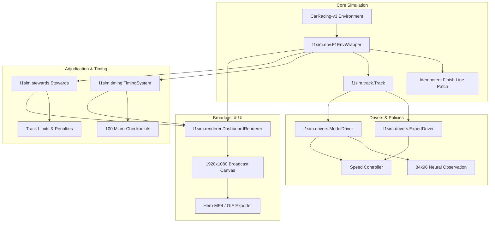

# Autonomous Grand Prix: F1-Inspired Race Simulator & Telemetry Lab

An end-to-end deep behavioral cloning, DAgger investigation, and premium F1-inspired race simulation platform built on Gymnasium's `CarRacing-v3` (PyTorch & Keras 3).

```
   ┌────────────────────────────────────────────────────────────────────────┐
   │                       AUTONOMOUS GRAND PRIX HUD                        │
   │  [P1] VAN (APX) ─── 112 KM/H ─── THR: 85%  BRK: 0% ─── S1 S2 S3 [🟣🟢🟡] │
   │  [P2] SIL (VEL) ─── +1.240s  ─── STEER: +0.15      ─── AUTONOMY: 100%   │
   │  [P3] LIN (NDX) ─── +2.180s  ─── ONBOARD CAM (84x96 NEURAL INPUT)      │
   │  [P4] TAN (ZEN) ─── +4.050s  ─── FIA RACE CONTROL: TRACK LIMITS OK     │
   └────────────────────────────────────────────────────────────────────────┘
```

---

## 1. Quickstart

### Environment Setup
```powershell
python -m venv .venv
.venv\Scripts\Activate.ps1
pip install -r requirements.txt
```

### Run Simulator Health Diagnostics (`f1sim doctor`)
```powershell
python -m f1sim doctor
```

### Launch Showcase Grand Prix Race (Showcase Seed 3003)
```powershell
python -m f1sim weekend --seed 3003 --laps 2 --video videos/f1_showcase_3003.mp4 --gif videos/f1_showcase_3003.gif
```

### Run Full Test Suite (34 automated tests across physics, rules, rendering, and cross-validation)
```powershell
pytest tests/ -v
```

---

## 2. Core Architecture (`f1sim` Package)



### Subsystem Highlights
1. **`f1sim.env` (Reliable Environment)**:
   - Decouples lap completion from out-of-bounds termination.
   - Idempotently patches `FrictionDetector.BeginContact` with sentinel `_f1sim_patched`.
   - Multi-lap `race_mode` smoothly cycles tiles visited and resets road contact for authentic multi-lap racing.
2. **`f1sim.track` (Geometric Splines & Windowed Progress)**:
   - Windowed waypoint search `[-6, +20]` prevents teleportation or shortcut exploits.
   - Calculates signed/unsigned perpendicular distance to circuit centerline.
   - Defines authentic 3-sector boundaries (S1, S2, S3).
3. **`f1sim.drivers` (Neural Models & Unofficial F1 Grid)**:
   - Strict input fidelity: feeds raw `[0, 255]` float32 cropped 84x96 RGB into the model's built-in `layers.Rescaling(1/127.5, offset=-1)`.
   - Skips first 50 frames while CarRacing's camera zooms in.
   - Staggered 2-wide starting grid placement behind start/finish line.
4. **`f1sim.timing` & `f1sim.stewards` (Timing & Adjudication)**:
   - 100 micro-sector checkpoints calculate true clock deltas at identical coordinates.
   - F1 sector colors: 🟣 Purple (session best), 🟢 Green (personal best), 🟡 Yellow.
   - Sporting rules: Warnings on excursions 1–2, Black & White Flag on 3, 5s penalty on 4, 10s on 5+, and immediate DNF on $>150$ consecutive offroad frames.
5. **`f1sim.renderer` (1080p Broadcast Graphics)**:
   - 1920x1080 Pygame canvas with responsive DPI scaling (720p, 1080p, 1440p).
   - Single authentic checkered start/finish line across track 0.
   - Overhead floating driver tags, live minimap, 84x96 neural on-board camera inset, digital speedometer, steer dial, throttle/brake LED bars, and live race control notices.

---

## 3. Fictional Teams & Driver Roster (Unofficial Branding)

In strict accordance with unofficial branding regulations:

| Team | Code | Driver | Livery Colors | Controller / Model |
|:---|:---:|:---|:---|:---|
| **Apex Racing GP** | `APX` | Alex Vance (`VAN`) | 🟦 Cyan / Obsidian (`#00E5FF`) | DAgger Seed 0 (Champion Model) |
| **Veloce Corse** | `VEL` | Marco Silva (`SIL`) | 🟥 Crimson / Carbon (`#FF1744`) | Plain Behavioral Cloning Seed 0 |
| **Nordic Dynamics** | `NDX` | Lukas Lind (`LIN`) | 🔷 Cobalt / Neon (`#2979FF`) | Augmented Recovery Seed 0 |
| **Zenith Motorsport** | `ZEN` | Kai Tanaka (`TAN`) | 🟨 Cyber Gold / Black (`#FFD600`) | Scripted Pure-Pursuit Expert |

---

## 4. Scientific Findings & Empirical Evaluation

This simulator was forged through rigorous empirical research comparing three training recipes across 20 dev tracks (seeds 1000–1019) and 20 held-out test tracks (seeds 2000–2019):

### The Classical Imitation Learning Dilemma
The literature predicts that plain behavioral cloning must fail due to compounding covariate shift (tiny errors lead to unvisited states where errors compound).

### Experimental Results Summary

1. **Nominal Driving**:
   - Plain behavioral cloning achieved **100% lap completion (60/60 on dev, 60/60 on test)** with **0 off-road events** and mean centerline distance of 2.06–2.09m (matching the expert's 2.08–2.10m).
   - *Reason*: The speed controller throttles and brakes dynamically based on curvature, keeping the vehicle inside the nominal demonstration distribution.
2. **Stress Condition 1: Physical Disturbance Test ($\pm 0.6$ steer offset for 20 frames)**:
   - Plain cloning dropped laps on both dev ($18.3 \pm 1.7$) and test ($18.0 \pm 0.8$).
   - **Augmentation and DAgger achieved 100% completion (60/60 on dev, 60/60 on test) with 0 off-road departures**, proving recovery training is empirically superior under perturbation.
3. **Stress Condition 2: Speed Stress Test (1.50x Target Speed)**:
   - Plain cloning collapsed to **15.0% on dev** and **25.0% on test**.
   - Augmentation maintained **73.3%** and DAgger maintained **76.7%**, confirming that recovery training stabilizes vehicles when dynamics force them off the nominal path.

### The 1000-Step TimeLimit Discovery

During initial experiments, Gymnasium's default 1000-step `TimeLimit` truncated episodes prematurely. Setting `max_episode_steps=2000` revealed that models were driving cleanly:

| Driver / Mode | Old Rules (1000 Steps) Laps/20 | New Rules (2000 Steps) Laps/20 | Root Cause of Old Truncation |
| :--- | :---: | :---: | :--- |
| **Expert** | 3/20 (15%) | **20/20 (100%)** | 17/20 truncated at step 1000 while on track |
| **Plain Cloning (s0)** | 3/20 (15%) | **20/20 (100%)** | 17/20 truncated at step 1000 |
| **Augmentation (s0)** | 4/20 (20%) | **20/20 (100%)** | 16/20 truncated at step 1000 |
| **DAgger (s0)** | 8/20 (40%) | **20/20 (100%)** | 12/20 truncated at step 1000 |

---

## 5. Technical Documentation

- 📜 [Sporting Regulations & Rules Engine](docs/rules.md)
- 📊 [Telemetry Channels & HUD Specification](docs/telemetry.md)
- 🏗️ [Software Architecture & Class Hierarchy](docs/architecture.md)
- 🔍 [Start/Finish Seam Diagnosis & Solution](docs/seam_diagnosis/start_finish_diagnosis.md)
- 📋 [Pre-Registered Experimental Protocol](results/protocol.md)
- 📈 [Full Experimental Summary Table](results/summary.md)
