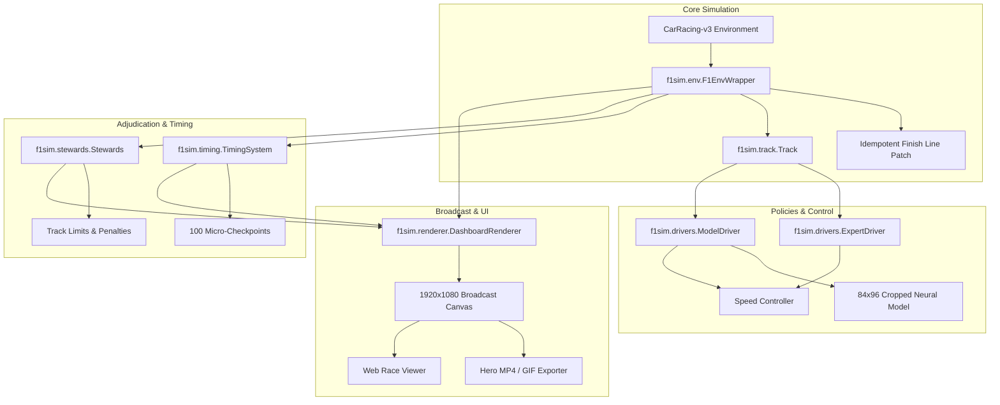

# System Architecture & Engineering Design

This document details the modular software architecture of the `f1sim` simulation engine and broadcast suite.

---

## 1. Modular Subsystems

### `f1sim.env` (Environment & Patching)
- **Problem Solved**: Gymnasium's native `CarRacing-v3` has two known bugs:
  1. A silent 1000-step `TimeLimit` wrapper that truncates legitimate laps.
  2. A race condition where driving outside the playfield sets `terminated=True`, which naive scripts misclassified as a completed lap.
- **Solution**:
  - `apply_finish_line_patch()`: Idempotently wraps `FrictionDetector.BeginContact` with a sentinel `_f1sim_patched` attribute to detect lap crossing when visited tiles $> 95\%$.
  - `F1EnvWrapper`: Explicitly decouples `lap_finished` from `out_of_bounds`, normalizes actions, and provides a multi-lap `race_mode`.

### `f1sim.track` (Geometry & Windowed Tracking)
- **Problem Solved**: Global nearest-neighbor search jumps or teleports when tracks loop or self-intersect.
- **Solution**:
  - Constrained local window search `[-6, +20]` along track nodes.
  - Continuous fractional progress interpolation along track tangent vectors.
  - Perpendicular signed and unsigned centre-line distance calculation.

### `f1sim.drivers` (Policies & Fictional Teams)
- **Integrity Guarantee**:
  - Models receive the exact 84x96 cropped RGB gym observation with float32 pixel values.
  - Fictional teams adhere to unofficial branding rules: `APX` (Apex Racing GP), `VEL` (Veloce Corse), `NDX` (Nordic Dynamics), `ZEN` (Zenith Motorsport).

### `f1sim.timing` & `f1sim.stewards` (Timing & Adjudication)
- **Precision**: 100 micro-sector checkpoints calculate true clock deltas $(\Delta t = t_B - t_A)$ at common physical coordinates.
- **Regulation**:
  - Excursions 1-2: Warning.
  - Excursion 3: Black & White Flag.
  - Excursion 4: 5s Time Penalty.
  - Excursions 5+: 10s Time Penalties.
  - Consecutive off-road $> 150$ frames: Immediate DNF / Retirement.

### `f1sim.renderer` (Broadcast Graphics)
- 1920x1080 Pygame canvas with responsive DPI scaling (720p, 1080p, 1440p).
- Single authentic checkered start/finish line at waypoint 0.
- Live follow-camera, minimap, driver cam inset (84x96), speedometer, steer dial, throttle/brake gauges.

### `f1sim.world.MultiCarWorld` (Shared-World Physics Engine)
- **Problem Solved**: Original simulation created one independent Box2D world per car, preventing vehicle collisions and wheel-to-wheel racing.
- **Solution**:
  - Unified Box2D physics world hosting 6 concurrent Car objects (Car 0 = `uw.car`, Cars 1..5 = `car_dynamics.Car(uw.world, ...)`).
  - Hull-to-hull Box2D contact solver preventing vehicle overlap and high-speed tunneling.
  - Per-car observation generation with zero-overhead swap-and-restore rendering for neural policies.
  - Full Race Lifecycle state machine (`GRID` -> `LIGHTS` -> `RACING` -> `CHEQUERED` -> `FINISHING` -> `COOLDOWN` -> `RESULTS`).
  - Session ends exactly 750 steps (15.0s @ 50 FPS) after the last classified car crosses the finish line.
  - Geometric at-fault steward penalties (+5s assessed to trailing car during rear-end collisions).
  - Dual traffic modes: `--traffic contact` (physical contact) and `--traffic follow` (multi-stage distance braking).

### `f1sim.live` (Real-Time WebSocket Broadcaster)
- Zero-dependency RFC 6455 pure-Python WebSocket server streaming 50 FPS telemetry packets to 3D WebGL viewer.
- Integrated HTTP static server for local viewer hosting.
- Replay generator (`python -m f1sim make_replays --n 8`) maintaining the web catalog `docs/viewer/data/index.json`.

### `f1sim.custom_track` (Custom Track & Circuit Diagnostics)
- `CustomTrackEnv`: Gymnasium-compatible CarRacing environment utilizing custom geometry from `track.json` or glTF polyline ("centerline"/"startline") with labelled experimental auto-extraction fallback.
- Strictly adheres to installed Gymnasium CarRacing constants: uses `TRACK_WIDTH` (`40 / 6.0 = 6.6667m`), Box2D polygon fixtures, sensors, and road tile coloring.
- Automatic warning if expected lap time exceeds 3 minutes (180s).
- Comprehensive validation suite: Scripted expert lap completion (>85% track coverage, reward >900), honest model evaluation without retraining, 50-track corner radii distribution comparison, alignment check, and horizontal mirror symmetry test.
